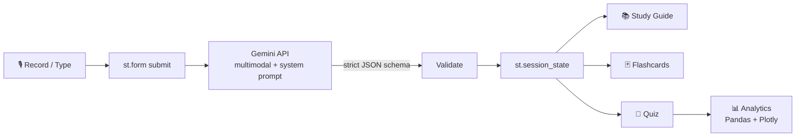

```
╔═══════════════════════════════════════════════════════════╗
║   🎙️  VOICETOFLASHCARDS AI                                 ║
║   speak your lecture. master your subject.                  ║
╚═══════════════════════════════════════════════════════════╝
```

**[🔗 Live App](https://voice-to-flashcards-2dpt3jhfqmdrrkwjwbjk2a.streamlit.app/)** &nbsp;·&nbsp; **[📐 Architecture](./docs/architecture.md)** &nbsp;·&nbsp; **[📄 Technical Design](./docs/technical_design.md)**

---

## `$ problem`

You just left a lecture. Your notes are a chaotic voice memo of you
talking to yourself, half in order, half not. Turning that into
anything study-ready normally takes another 30 minutes of manual work.

## `$ solution`

Record it once. VoiceToFlashcards AI transcribes it, extracts the real
concepts, and hands you back a full study pack:

```
🎧 raw voice recording
   ↓
📝 clean transcript
   ↓
📚 structured study guide
   ↓
🃏 flashcards
   ↓
🧠 5-question quiz
   ↓
📊 performance analytics
```

## `$ features`

```
✔ Microphone recording (st.audio_input) with typed-notes fallback
✔ Gemini multimodal audio → structured JSON in one call
✔ Specialized system-instruction prompt engineering (not a chatbot)
✔ Dynamic per-request context via f-strings (subject/difficulty/goal)
✔ Flashcard review mode — known / review / unseen tracking
✔ 5-question quiz with instant grading + explanations
✔ Analytics dashboard — Plotly charts over Pandas DataFrames
✔ Study history with reload-a-past-session support
✔ Export to Markdown / CSV — study guide, flashcards, quiz, full pack
✔ Zero local system dependencies — deploys clean to Streamlit Cloud
```

## `$ tech stack`

```
frontend / app     Streamlit
AI                 Google Gemini (gemini-3.6-flash, multimodal audio)
data                Pandas, Plotly
state               st.session_state (centralized in state_manager.py)
deployment          Streamlit Community Cloud
```

## `$ architecture`



Full data flow and layer-by-layer breakdown: [`docs/architecture.md`](./docs/architecture.md).
Prompt engineering strategy, error handling, and security notes: [`docs/technical_design.md`](./docs/technical_design.md).

## `$ prompt engineering`

Gemini isn't called with a single vague question. It's given a fixed
system instruction defining its role, hard constraints against
hallucination, and an exact JSON output schema — then a dynamic
f-string layer injects per-request context (subject, difficulty,
learning goal) that actually changes the depth and phrasing of the
output. See `modules/prompt_engine.py`.

## `$ run it locally`

```bash
git clone https://github.com/SarikaDorepally/voice-to-flashcards.git
cd voice-to-flashcards
pip install -r requirements.txt

cp .streamlit/secrets.toml.example .streamlit/secrets.toml
# paste your Gemini API key into secrets.toml

streamlit run app.py
```

Get a free Gemini API key at [aistudio.google.com/apikey](https://aistudio.google.com/apikey).

## `$ environment variables / secrets`

```toml
# .streamlit/secrets.toml (gitignored — never commit this file)
GEMINI_API_KEY = "your-key-here"
```

## `$ deploy to streamlit community cloud`

1. Push this repo to GitHub.
2. Go to [share.streamlit.io](https://share.streamlit.io) → **New app** → connect the repo.
3. Set the main file path to `app.py`.
4. In **Settings → Secrets**, add:
   ```toml
   GEMINI_API_KEY = "your-key-here"
   ```
5. Deploy. Paste the live URL back into this README.

## `$ project structure`

```
voice-to-flashcards/
├── app.py                       # UI + routing only
├── requirements.txt
├── README.md
├── .gitignore
├── .streamlit/
│   └── secrets.toml.example
├── modules/
│   ├── gemini_service.py        # Gemini API wrapper
│   ├── prompt_engine.py         # system instruction + dynamic prompts
│   ├── audio_processor.py       # input validation
│   ├── flashcard_engine.py      # flashcard progress logic
│   ├── quiz_engine.py           # quiz grading logic
│   ├── analytics.py             # Pandas + Plotly pipeline
│   └── state_manager.py         # session_state single source of truth
├── utils/
│   ├── validators.py            # Gemini output schema validation
│   ├── exporters.py             # Markdown/CSV export builders
│   └── helpers.py
└── docs/
    ├── architecture.md          # Mermaid diagram + layer breakdown
    └── technical_design.md      # full technical design doc
```

## `$ future improvements`

- Persistent history storage (SQLite / Sheets) beyond a single session
- Automatic retry with backoff on transient Gemini failures
- Multi-language lecture support
- Spaced-repetition scheduling for flashcards

---

`built by Sarika Dorepally` · [GitHub](https://github.com/SarikaDorepally) · [LinkedIn](https://linkedin.com/in/dorepally-sarika-646b92288)

Built for the MirAI School of Technology AI Builder Track capstone.
