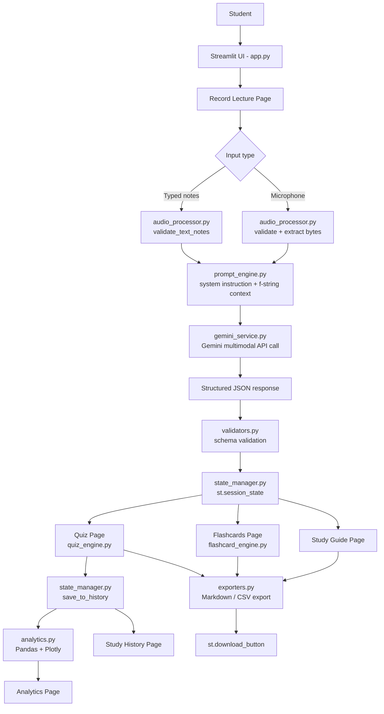

# System Architecture — VoiceToFlashcards AI

## Layer responsibilities

| Layer | Files | Responsibility |
|---|---|---|
| UI / routing | `app.py` | Page navigation, CSS, widget rendering — no business logic |
| Prompt engineering | `modules/prompt_engine.py` | Fixed system instruction + dynamic f-string context per request |
| AI integration | `modules/gemini_service.py` | Gemini API call, key resolution, JSON parsing/cleanup |
| Input validation | `modules/audio_processor.py` | Audio/text input validation before it ever reaches Gemini |
| Output validation | `utils/validators.py` | Confirms Gemini's JSON matches the required schema before display |
| State | `modules/state_manager.py` | Single source of truth for all `st.session_state` keys |
| Domain logic | `modules/flashcard_engine.py`, `modules/quiz_engine.py` | Pure functions — flashcard progress, quiz grading — no Streamlit imports |
| Analytics | `modules/analytics.py` | Session history → Pandas DataFrame → Plotly figures |
| Export | `utils/exporters.py` | Builds in-memory Markdown/CSV payloads for download buttons |

## Data flow, end to end

1. Student records audio (or types notes) on the **Record Lecture** page, inside a single `st.form` so nothing is sent to Gemini until the form is submitted.
2. `audio_processor.py` validates the input isn't empty before any API call is made.
3. `prompt_engine.py` builds the final prompt: a fixed system instruction plus dynamic context (subject, difficulty, learning goal) injected via f-strings.
4. `gemini_service.py` sends the audio (or text) + prompt to Gemini with `response_mime_type: application/json`, enforcing structured output.
5. `utils/validators.py` checks the returned JSON has all required fields before it's trusted by the UI.
6. `state_manager.py` stores the validated pack in `st.session_state`, so page navigation and reruns never lose generated content or trigger a duplicate API call.
7. The Study Guide, Flashcards, and Quiz pages all read from the same session-state pack.
8. On quiz completion, the result is saved into `study_history`, which `analytics.py` turns into a Pandas DataFrame for the Analytics and Study History pages.
9. Any page can trigger an export via `utils/exporters.py`, which returns an in-memory string for `st.download_button` — no filesystem writes, which keeps this compatible with Streamlit Community Cloud's read-only filesystem.
